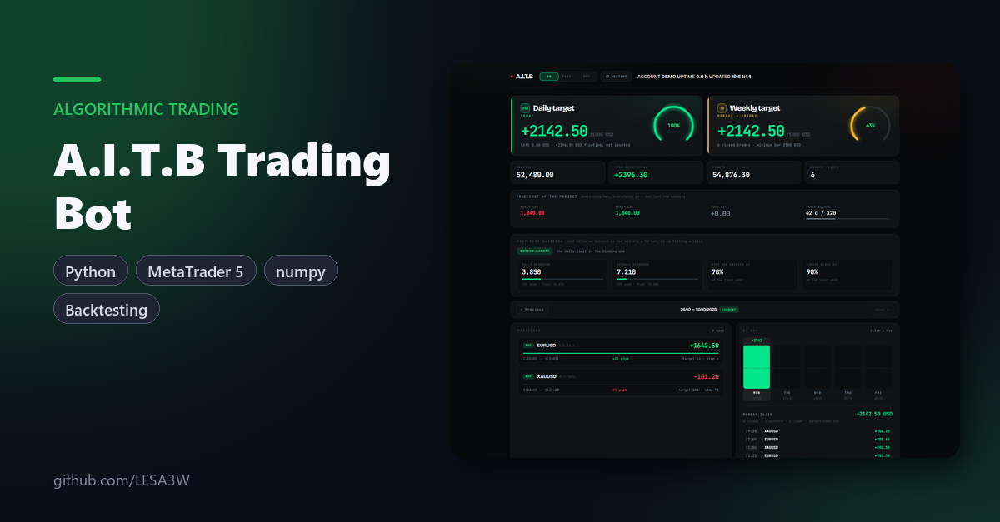
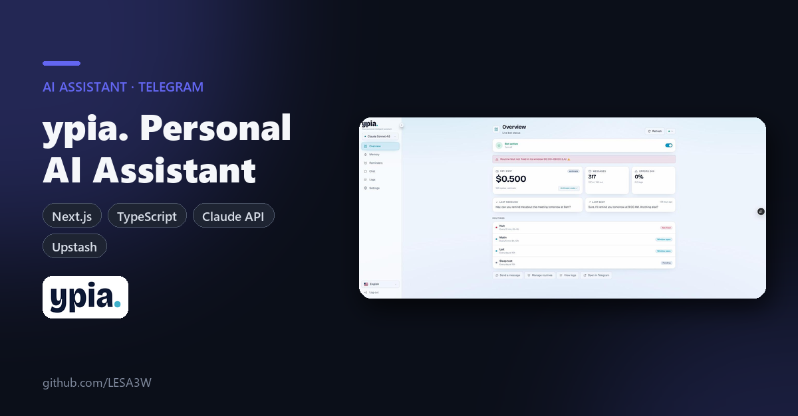
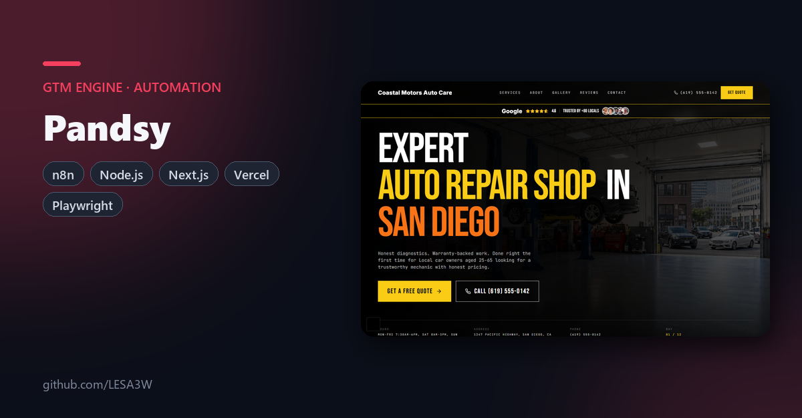
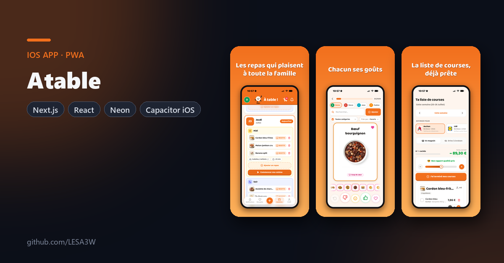
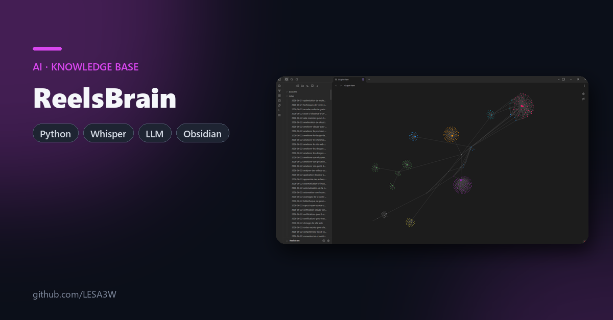
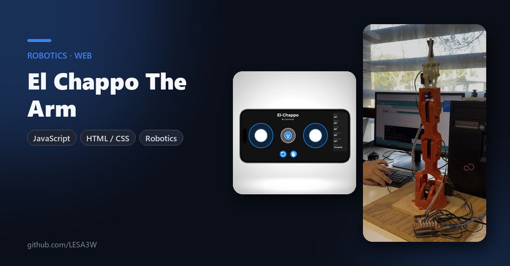
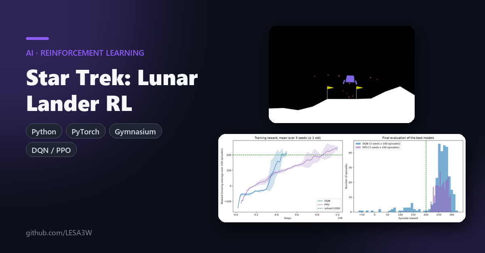
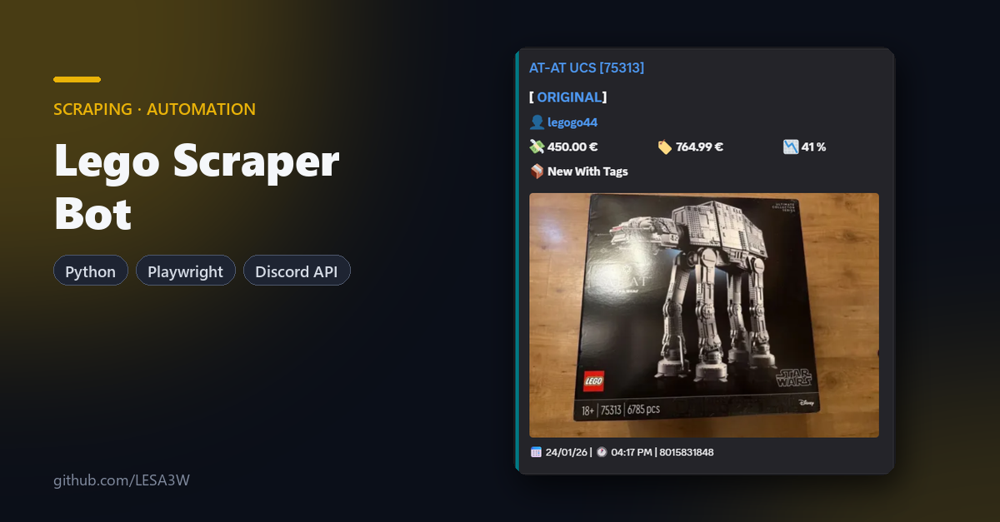
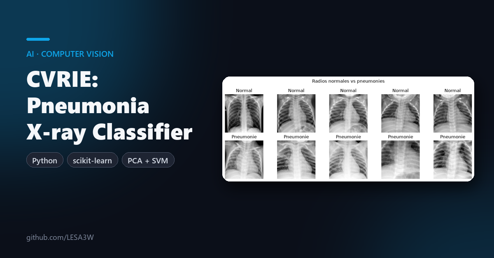

  

<h1 align="center">Hello I'm Paul !</h1>

<!-- Intro -->

    

<!-- Projects -->
<h1 align="center">My latest projects 💡</h1>
<table>
<tr>
<td width="50%" valign="top">

<h3><a href="https://github.com/LESA3W/aitb">📈 A.I.T.B Trading Bot</a></h3>

Autonomous MetaTrader 5 trading bot with its own <b>backtesting engine</b>, walk-forward research, prop firm guard rail and live dashboards.

<a href="https://github.com/LESA3W/aitb">Code</a>

</td>
<td width="50%" valign="top">

<h3><a href="https://github.com/LESA3W/ypia-app">🧠 ypia.</a></h3>

Claude-powered assistant that lives in Telegram, <b>remembers you</b> and runs proactive routines, plus the private web console to steer it.

<a href="https://github.com/LESA3W/ypia-app">Code</a>

</td>
</tr>
<tr>
<td width="50%" valign="top">

<h3><a href="https://github.com/LESA3W/Pandsy">🏭 Pandsy</a></h3>

GTM engine that built and cold-emailed <b>2,887 local-business websites</b> in 4 months: scraping, ~90 s site generation, deploy and outreach, orchestrated by n8n.

<a href="https://github.com/LESA3W/Pandsy">Code &amp; write-up</a>

</td>
<td width="50%" valign="top">

<h3><a href="https://github.com/LESA3W/atable-app">🍽️ Atable</a></h3>

Family meal planner, <b>live on the App Store</b>. Everyone sets their tastes, the app suggests meals the whole family likes and builds the shopping list.

<a href="https://apps.apple.com/fr/app/ataaable/id6789919604">App Store</a> · <a href="https://a-taaaable.vercel.app">Web app</a> · <a href="https://github.com/LESA3W/atable-app">Code</a>

</td>
</tr>
<tr>
<td width="50%" valign="top">

<h3><a href="https://github.com/LESA3W/reelsbrain">🎞️ ReelsBrain</a></h3>

Second brain that turns saved Reels, TikToks and YouTube videos into <b>searchable Obsidian notes</b>, transcribed and distilled by AI.

<a href="https://github.com/LESA3W/reelsbrain">Code</a>

</td>
<td width="50%" valign="top">

<h3><a href="https://github.com/LESA3W/El_Chappo">🦾 El Chappo The Arm</a></h3>

Robotic arm <b>built from A to Z</b> by replicating Arduino's orange arm kit, driven from the browser with joysticks and live motor feedback.

<a href="https://lesa3w.github.io/El_Chappo/">Live demo</a> · <a href="https://github.com/LESA3W/El_Chappo">Code</a>

</td>
</tr>
<tr>
<td width="50%" valign="top">

<h3>🚀 Star Trek · Epitech</h3>

DQN and PPO agents that learn to land on the Moon. PPO solves Lunar Lander with a <b>259.6 mean score</b> and 299/300 clean landings.

<i>School project, private repo</i>

</td>
<td width="50%" valign="top">

<h3><a href="https://github.com/LESA3W/Arduino_Robot_Sumo">🏆 Chappie Sumo Robot</a></h3>

Arduino program of the robot that took <b>2nd place</b> at the 2024 regional Robot Sumo contest (IUT de Bordeaux, GEII).

<a href="https://github.com/LESA3W/Arduino_Robot_Sumo">Code</a> · <a href="https://www.linkedin.com/posts/visite-des-%C3%A9tudiants-de-tsukuba-suite-et-ugcPost-7184459110245945344-IYI2/">Competition post</a>

</td>
</tr>
<tr>
<td width="50%" valign="top">

<h3><a href="https://github.com/LESA3W/Lego_Scraper_Bot">🤖 Lego Scraper Bot</a></h3>

Discord bot that scans LeBonCoin and Vinted <b>in real time</b> for underpriced Lego sets and filters out scams.

<a href="https://github.com/LESA3W/Lego_Scraper_Bot">Code</a>

</td>
<td width="50%" valign="top">

<h3>🩻 CVRIE · Epitech</h3>

Chest X-ray pneumonia classifier (PCA + SVM). <b>90.7% accuracy</b> on MedMNIST, ahead of the paper's ResNet-18 and ResNet-50 baselines.

<i>School project, private repo</i>

</td>
</tr>
</table>

<h1 align="center"></h1>

<!-- Languages and Tools -->
<h1 align="center">Languages and Tools 🛠</h1>

<h3 align="center">Front</h3>

    
    
    
    

<h3 align="center">Backend</h3>

    
    
    

<h3 align="center">Languages</h3>

	<a href="https://www.dev-cpp.com/" target="_blank"> 
    
    <a href="https://www.java.com/en/" target="_blank"> 
    
    

<h3 align="center">Others</h3>

	
	
	

<h1 align="center"></h1>
<!-- Contact -->
<h1 align="center">⬇️ To contact me ⬇️</h1>

  
  

<h1 align="center"></h1>
<h1 align="center">📌 Pinned Projects ⬇️</h1>
